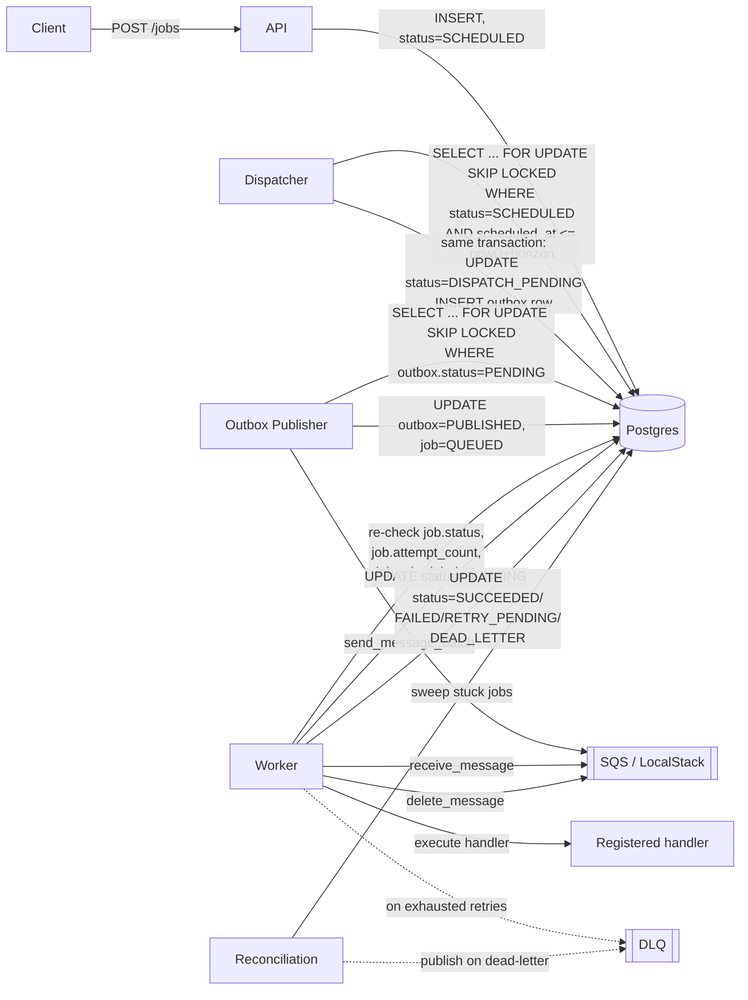
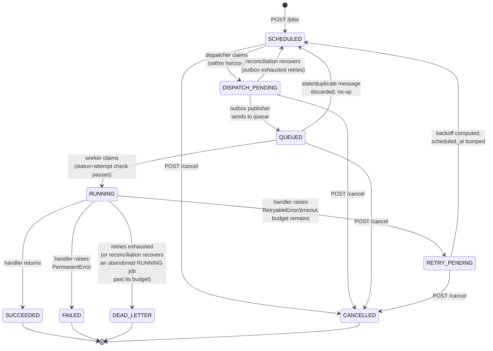

# Chronos — Architecture

## Components and responsibilities

| Component | Responsibility | Touches |
|---|---|---|
| **API** (`app/api/`) | REST interface: create/inspect/list/cancel/reschedule jobs, attempt history, health/ready/metrics | Postgres only — never the queue |
| **Dispatcher** (`app/scheduler/`) | Finds jobs approaching their scheduled time, claims them (`SCHEDULED → DISPATCH_PENDING`), writes an outbox row — atomically | Postgres only |
| **Outbox Publisher** (`app/publisher/`) | Reads pending outbox rows, publishes to the queue, marks them published and the job `QUEUED` | Postgres + Queue |
| **Worker** (`app/workers/`) | Consumes queue messages, validates authoritative job state, executes the registered handler, records the outcome | Postgres + Queue + the handler registry |
| **Reconciliation** (`app/reconciliation/`) | Periodic sweep recovering jobs stuck `DISPATCH_PENDING` (outbox exhausted) or `RUNNING` (worker crashed) | Postgres + Queue (DLQ only) |
| **Queue** (`app/queue/`) | Abstraction over SQS/LocalStack (`sqs.py`) and an in-memory fake (`memory.py`) — everything above talks to this interface, never to boto3 directly | — |

Postgres is the single source of truth for every job's state. The queue is a
delivery mechanism, not a record of truth — a message can be delayed, duplicated,
or lost, and the system is designed to survive all three without corrupting job
state (see `FAILURE_MODES.md`).

## Request flow

## Why the dispatcher and publisher are separate processes

This is the one design decision worth explaining up front, because it's the answer
to "how do you handle the dual-write problem between Postgres and SQS": **they
aren't actually two independent writes**. The dispatcher's claim and its outbox
write happen in one Postgres transaction — committed together or not at all. The
publisher is a separate process specifically so that a crash between "job claimed"
and "message actually sent to SQS" can never lose the job: the outbox row is
durable, committed Postgres state, not something held in a dispatcher process's
memory. If the publisher process dies mid-batch, the row is still `PENDING` and
gets picked up by any publisher replica on its next poll — see `FAILURE_MODES.md`
for the test that proves this (`test_outbox_survives_publisher_outage_with_no_data_loss`).

## Job lifecycle

Note what's *not* a legal transition: `RUNNING → CANCELLED`. A job actively
executing can't be safely interrupted mid-handler, so cancellation is best-effort —
see `app/models/states.py` and `FAILURE_MODES.md` for why this is documented
explicitly rather than silently attempted.

Retries deliberately reuse the exact same pipeline as a fresh job
(`RETRY_PENDING → SCHEDULED`, then the normal dispatch/queue/execute cycle) instead
of a parallel "retry path" — one pipeline to test and reason about, not two that can
drift out of sync. See `app/models/states.py`'s module docstring.

## Data model

Three tables (`app/models/`), one Alembic migration:

- **`jobs`** — the authoritative record. Indexed on `(status, scheduled_at)` for the
  dispatcher's horizon query, `(status, lease_expires_at)` for reconciliation's
  abandoned-RUNNING sweep, `(status, dispatched_at)` for its stuck-DISPATCH_PENDING
  sweep, and `created_at` for list pagination.
- **`outbox`** — one row per dispatch attempt, written atomically with the job's
  `SCHEDULED → DISPATCH_PENDING` transition. Indexed on `(status, created_at)` for
  the publisher's claim query.
- **`attempts`** — append-only execution history, one row per attempt, so
  `GET /jobs/{id}/attempts` shows the full retry trail (worker, timing, error) not
  just the latest state.

See `DESIGN_DECISIONS.md` for why status columns are `VARCHAR` + `CHECK` constraint
rather than a native Postgres `ENUM`, and other schema trade-offs.
