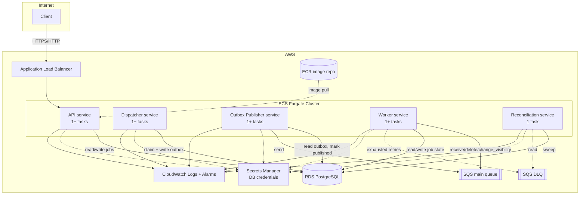

# AWS Deployment — Architecture, Setup, and Cost

**This is documentation and Infrastructure-as-Code only. Nothing here has been
applied. No AWS resources have been created and no cost has been incurred.**
Running `terraform apply` creates real, billed AWS resources — do not run it
without explicit approval, and understand the cost estimate in Section 4 first.

## 1. Architecture



This is the exact same five-service architecture as `docker-compose.yml` — the only
things that change between local and AWS are: the queue backend (LocalStack →
real SQS, selected by `AWS_ENDPOINT_URL` being unset), where secrets come from
(`.env` → Secrets Manager), and how logs/metrics are collected (stdout/Prometheus →
CloudWatch Logs). **No application code differs between environments.**

## 2. What's provisioned (`infra/aws/terraform/`)

| File | Resources |
|---|---|
| `network.tf` | Default VPC + subnets (demo mode), 3 security groups (ALB, ECS tasks, RDS) |
| `rds.tf` | RDS PostgreSQL 16, `db.t4g.micro` by default |
| `sqs.tf` | Main queue + DLQ, with SQS-native redrive as a backstop (see inline comment — the app's own retry/DLQ logic is the primary path) |
| `secrets.tf` | Random DB password, stored in Secrets Manager, never in Terraform-visible plaintext output |
| `ecr.tf` | One image repository, immutable tags, 7-day untagged-image cleanup |
| `iam.tf` | Execution role (pull image, read the one DB secret) + two task roles: API gets **no SQS permissions at all**; dispatcher/publisher/worker/reconciliation get SQS access scoped to exactly the two queue ARNs, nothing else |
| `ecs.tf` | Fargate cluster, one task definition + service per component (same image, different `command` — mirrors `docker-compose.yml`), an ALB in front of the API only |
| `cloudwatch.tf` | Log groups per service, alarms on DLQ depth, dead-letter events (via log metric filter), queue backlog, RDS CPU |

## 3. Prerequisites and setup

1. **AWS credentials** configured via the standard chain (`aws configure`, env
   vars, or an SSO profile) — never hardcoded, same rule the application follows.
2. **Terraform** ≥ 1.5, **Docker**, and the **AWS CLI**.
3. Build and push the image:
   ```bash
   aws ecr get-login-password --region us-east-1 | \
     docker login --username AWS --password-stdin <account-id>.dkr.ecr.us-east-1.amazonaws.com
   docker build --target prod -t chronos:latest .
   docker tag chronos:latest <account-id>.dkr.ecr.us-east-1.amazonaws.com/chronos-demo:v1
   docker push <account-id>.dkr.ecr.us-east-1.amazonaws.com/chronos-demo:v1
   ```
   (The ECR repository itself is created by Terraform in step 4 below — push after
   `terraform apply` creates it, or create the repo first with
   `terraform apply -target=aws_ecr_repository.chronos` if you want to push before
   the rest of the stack exists.)
4. ```bash
   cd infra/aws/terraform
   terraform init
   terraform plan -var="container_image=<account-id>.dkr.ecr.us-east-1.amazonaws.com/chronos-demo:v1"
   # Review the plan. Confirm the resource list and estimated changes match your
   # expectations before proceeding — this is the point to stop if anything looks
   # unexpected.
   terraform apply -var="container_image=<account-id>.dkr.ecr.us-east-1.amazonaws.com/chronos-demo:v1"
   ```
5. **Run the initial migration** — ECS services run long-lived processes, not
   one-shot jobs, so `alembic upgrade head` needs a separate one-off task:
   ```bash
   aws ecs run-task --cluster chronos-demo \
     --task-definition chronos-demo-api \
     --launch-type FARGATE \
     --network-configuration "awsvpcConfiguration={subnets=[<subnet-id>],securityGroups=[<ecs-tasks-sg-id>],assignPublicIp=ENABLED}" \
     --overrides '{"containerOverrides":[{"name":"api","command":["alembic","upgrade","head"]}]}'
   ```
6. Visit `terraform output api_url` and confirm `GET /health` and `GET /ready`
   respond.

## 4. Cost estimate (demo mode, `us-east-1`, approximate, as of this writing)

| Resource | Estimate |
|---|---|
| RDS `db.t4g.micro`, single-AZ, 20GB gp3 | ~$13/mo (+storage/backup) |
| ECS Fargate, 5 services × 1 task each (mixed 0.25-0.5 vCPU / 0.5-1GB) | ~$25-35/mo if left running continuously |
| Application Load Balancer | ~$16/mo + data processed |
| SQS | Negligible at demo volume (first 1M requests/mo free) |
| Secrets Manager | ~$0.40/mo per secret |
| CloudWatch Logs | Usage-based; negligible at demo volume |
| ECR | Negligible at demo volume |
| **Total if left running 24/7** | **roughly $55-70/mo** |

This is a **rough order of magnitude**, not a quote — actual AWS pricing varies by
region and changes over time; check the [AWS Pricing Calculator](https://calculator.aws)
for current numbers before committing to a deployment. The single biggest lever for
a short-lived demo: **tear it down when you're done** (Section 6) rather than
leaving it running — most of this cost is time-based, not usage-based.

## 5. Hardening for real production

Several choices here are explicitly demo-mode trade-offs, not production
recommendations. Before using this for anything real:

- **Private subnets + NAT Gateway** for ECS tasks (currently public subnets with
  public IPs, to avoid NAT Gateway's ~$32/mo even-when-idle cost).
- **Multi-AZ RDS** (`var.demo_mode = false` already flips this) and a real backup
  retention window (7+ days, already defaulted when `demo_mode = false`).
- **HTTPS on the ALB** via an ACM certificate + a 443 listener (currently HTTP-only
  on port 80).
- **RDS Proxy** or a connection pooler (PgBouncer) in front of RDS if running more
  than a couple of API/worker replicas — BENCHMARKS.md's finding that the DB
  connection pool saturates under load applies here too, and matters more with
  multiple task replicas each holding their own pool.
- **WAF** in front of the ALB if the API is public-facing in any real sense.
- **Separate Terraform workspaces/state per environment** (this config has no
  environment separation beyond the `environment` variable name — real production
  would want isolated state files and probably isolated AWS accounts).
- **CI/CD** for image builds and `terraform plan`/`apply` (this doc describes
  manual steps; a real deployment would run these through a pipeline with plan
  output requiring review before apply).

## 6. Tearing down

```bash
cd infra/aws/terraform
terraform destroy
```

`skip_final_snapshot = true` and `recovery_window_in_days = 0` in demo mode mean
the RDS instance and the Secrets Manager secret are deleted immediately, with no
final snapshot and no recovery window — intentional for a demo you're tearing down
completely, and exactly why `var.demo_mode` defaults to `true` with these documented
instead of silently applied.
